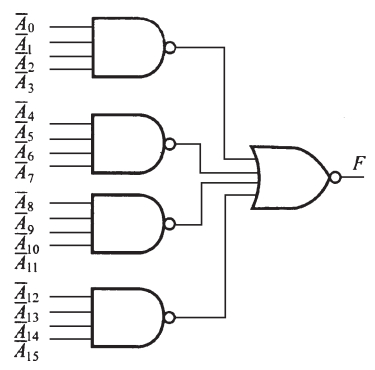

# 2026数字逻辑 - 第二周作业题目与作答清单

## 一、单选题

### R2-1 (分数: 2分)

双向数据总线可以采用（ ）构成。

**选项：**

- [ ] **A.** 数据选择器
- [ ] **B.** 译码器
- [x] **C.** 三态门
- [ ] **D.** 数据分配器

### R2-2 (分数: 2分)

若ABCDEFGH为最小项，则它的逻辑相邻项有（ ）个。

**选项：**

- [x] **A.** 8
- [ ] **B.** 32
- [ ] **C.** 64
- [ ] **D.** 16

### R2-3 (分数: 2分)

电路完成的功能是（ ）。

**选项：**

- [x] **A.** A7--A0等于B7--B0时，输出=1
- [ ] **B.** 只要A7--A0输入为1时，输出=1
- [ ] **C.** A7--A0大于B7--B0时，输出=1
- [ ] **D.** A7--A0小于B7--B0时，输出=1

### R2-4 (分数: 2分)

卡诺图上变量的取值顺序是采用（ ）的形式，以便能够用几何上的相邻关系表示逻辑上的相邻。

**选项：**

- [ ] **A.** ASCII码
- [ ] **B.** 二进制码
- [ ] **C.** 十进制码
- [x] **D.** 格雷码（循环码）

### R2-5 (分数: 2分)

将奇数个非门首尾相连构成闭环环形振荡器，下面说法正确的是（ ）。

**选项：**

- [ ] **A.** 若改为4个非门闭环，电路同样可以起振输出方波。
- [ ] **B.** 采用3个非门闭环，电路起振后，输出信号频率和非门的传输延迟无关。
- [ ] **C.** 采用3个非门闭环，如果没有门电路的传输延迟，也能产生振荡。
- [x] **D.** 环形振荡器振荡的本质，是利用门电路的传输延迟形成。

### R2-6 (分数: 2分)

以下哪个逻辑可以实现加法的“本位和”的运算（ ）。

**选项：**

- [ ] **A.** 与非
- [x] **B.** 异或
- [ ] **C.** 或非
- [ ] **D.** 同或

### R2-7 (分数: 2分)

设计一个四位二进制码的奇偶位发生器（假定采用偶检验码），需要（ ）个异或门。

**选项：**

- [ ] **A.** 5
- [x] **B.** 3
- [ ] **C.** 2
- [ ] **D.** 4

### R2-8 (分数: 2分)

已知逻辑表达式 $F=AB+\overline{A}C+\overline{B}C$，与它功能相等的函数表达式是（ ）。

**选项：**

- [ ] **A.** $F=AB$
- [x] **B.** $F=AB+C$
- [ ] **C.** $F=AB+\overline{B}C$
- [ ] **D.** $F=AB+\overline{A}C$

## 二、主观题

### R8-1 第一章第8题 (分数: 10分)

用布尔代数化简各逻辑函数表达式。

(1) $F = A + ABC + A\overline{B}\,\overline{C} + CB + \overline{C}\,\overline{B}$；

(2) $F = A\overline{B}CD + AB\overline{C}\,\overline{D} + A\overline{B} + A\overline{D} + A\overline{B}C$；

(3) $F = ABC\overline{D} + ABD + BC\overline{D} + ABCD + B\overline{C}$；

(4) $F = \overline{\overline{AC + \overline{A}BC} + \overline{B}C + AB\overline{C}}$。

---

### R8-2 第一章第(10)题 (分数: 10分)

用卡诺图化简下列各式：

(1) $F=\overline{AC+\overline{A}BC+\overline{B}C}+AB\overline{C}$；

(2) $F=A\overline{B}CD+AB\overline{C}\,\overline{D}+A\overline{B}+A\overline{D}+A\overline{B}C$；

(3) $F(A,B,C,D)=\sum m(0,1,2,5,6,7,8,9,13,14)$；

(4) $F(A,B,C,D)=\sum m(0,13,14,15)+\sum \phi(1,2,3,9,10,11)$。

---

### R8-3 等价变换 (分数: 10分)

分别用与非门实现下列函数，写出表达式并画图。

(1) $F = AB\overline{C} + A\overline{B}\,\overline{C}$；

(2) $F=\overline{(A+B)(C+D)}$

(3) $F(A,B,C,D)=\sum m(0,1,2,4,6,10,14,15)$，用卡诺图化简后用与非门，或非门实现。

---

### R8-4 第二章第(4)题 (分数: 10分)

图所示为数据总线上的一种判零电路，写出 $F$ 的逻辑表达式，说明该电路的逻辑功能。（$\overline{A}$ 表示反变量输入，即 $A$ 取反）

---
