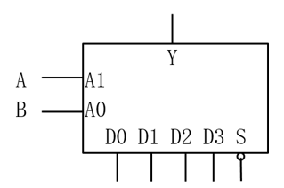
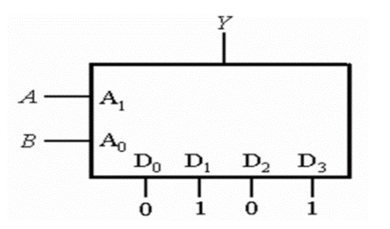
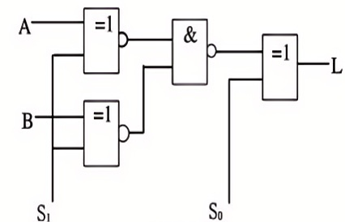

# 2026数字逻辑 - 第三周作业题目与作答清单

## 一、单选题

### R2-1 (分数: 2分)

利用四选1数据选择器实现函数 $F = \overline{A}C + AB + AD$，数据输入端接法为（ ）。S接低电平‘0’。

（提示：将F的卡诺图做出来，在卡诺图上地址的控制范围内化简）

**选项：**

- [ ] **A.** D0=0,D1=C,D2=1,D3=0
- [ ] **B.** D0=C,D1=C,D2=0,D3=1
- [x] **C.** D0=C,D1=C,D2=D,D3=1
- [ ] **D.** D0=D1=C,D2=1,D3=D

### R2-2 (分数: 2分)

用四选一数据选择器实现函数 $Y = \overline{A_1}\,\overline{A_0} + \overline{A_1}A_0$，应使（ ）。

**选项：**

- [ ] **A.** D0=D2=0，D1=D3=1
- [ ] **B.** D0=D1=0，D2=D3=1
- [x] **C.** D0=D1=1，D2=D3=0
- [ ] **D.** D0=D2=1，D1=D3=0

### R2-3 (分数: 2分)

若实现64选1的数据选择器需要（ ）个地址控制信号。

**选项：**

- [x] **A.** 6
- [ ] **B.** 7
- [ ] **C.** 4
- [ ] **D.** 5

### R2-4 (分数: 2分)

一位全加器的输入输出描述，正确的是（ ）。

**选项：**

- [ ] **A.** 输入两个操作数 A、B；输出本位和 S 以及进位 $C_{out}$
- [x] **B.** 输入 A、B、低位进位 $C_{in}$；输出本位和 S 以及向高位进位 $C_{out}$
- [ ] **C.** 全加器的进位输出仅由 A、B 决定，与 $C_{in}$ 无关
- [ ] **D.** 使用两个半加器就可以直接构成一个全加器

### R2-5 (分数: 2分)

下图为数据选择器构成的函数发生器，其输出逻辑式为

**选项：**

- [ ] **A.** $Y=A$
- [x] **B.** $Y=\overline{A}B$
- [ ] **C.** $Y=B$
- [ ] **D.** $Y=AB$

### R2-6 (分数: 2分)

关于一位半加器，下列叙述正确的是（ ）。

**选项：**

- [ ] **A.** 半加器共有 3 个输入，2 个输出
- [ ] **B.** 半加器可以直接用来实现多位二进制加法的最低位以外的任意位
- [x] **C.** 半加器完成两个一位二进制数相加，输出本位和、向高位进位
- [ ] **D.** 半加器输入包含来自低位的进位Cin

### R2-7 (分数: 2分)

关于组合逻辑电路，下面正确的说法是（ ）。

**选项：**

- [x] **A.** 输出仅取决于该时刻的输入状态，与电路原来状态无关
- [ ] **B.** 可实现“记忆”的逻辑功能
- [ ] **C.** 可构成“反馈型”的电路结构
- [ ] **D.** 输出状态由当前输入和以往状态共同决定

### R2-8 (分数: 2分)

图示电路，以下说法正确的是（ ）。

**选项：**

- [ ] **A.** 电路可以起振，产生方波，其周期为非门延迟时间 $t_{pd}$ 的3倍
- [x] **B.** 电路可以起振，产生方波，其周期为非门延迟时间 $t_{pd}$ 的6倍
- [ ] **C.** 电路为闭环，没有输入，所以电路中没有产生波形
- [ ] **D.** 电路可以起振，产生方波，周期为非门延迟时间 $t_{pd}$ 的9倍

## 二、主观题

### R8-1 组合分析 (分数: 10分)

分析如图所示组合电路，写出输出 $L$ 的逻辑表达式，并说明当控制端 $S_1, S_0$ 取不同值时电路的逻辑功能。

---

### R8-2 第二章第(9)题 (分数: 10分)

用红、黄、绿三个指示灯表示三台设备的工作情况：绿灯亮表示全部正常；红灯亮表示有一台不正常；黄灯亮表示有两台不正常；红、黄灯全亮表示三台都不正常。

1. 列写真值表；
2. 用卡诺图求最简表达式；
3. 画出用与非门实现的控制电路。

---

### R8-3 第二章第(19)题 (分数: 10分)

19. 设 $A$、$B$、$C$ 为保密锁的 3 个按键，当 $A$ 键单独按下时，锁既不打开也不报警，只有当 $A$、$B$ 或者 $A$、$C$ 分别同时按下时，锁才能被打开；当不符合上述组合状态时，将发出报警信息。请设计此保密锁的逻辑电路（$F$ 为开锁信号，$G$ 为报警信号）。

(1) 列出真值表；

(2) 用卡诺图求最简逻辑表达式；

(3) 画出用与非门实现的电路图。

（提示A,B,C同时为0时，既不开锁也不报警）

---

### R8-4 第二章第10题 (分数: 10分)

用双四选一的数据选择器74LS153和与非门，实现将8421循环码转换至8421BCD码。（按格雷码-BCD码的转换规律得到），下表是8421对应的格雷码。

| 输入 | 输出 |
| :---: | :---: |
| 0000 | 0000 |
| 0001 | 0001 |
| 0010 | 0011 |
| 0011 | 0010 |
| 0100 | 0110 |
| 0101 | 0111 |
| 0110 | 0101 |
| 0111 | 0100 |
| 1000 | 1100 |
| 1001 | 1101 |

（注意：真值表中有6个无关项）

---
