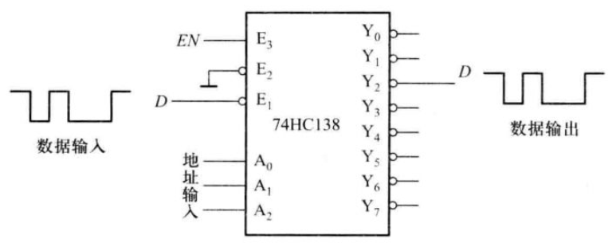
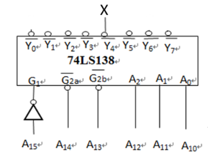
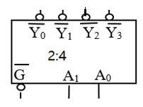
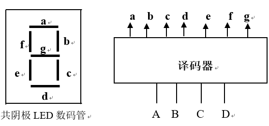
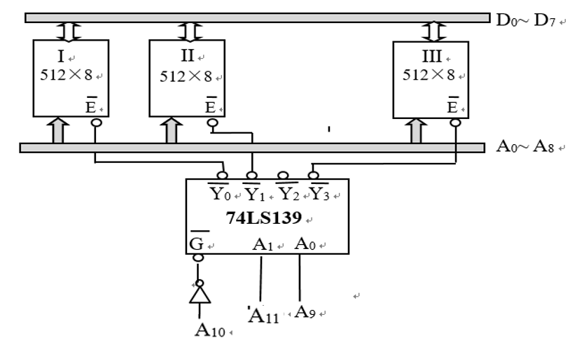
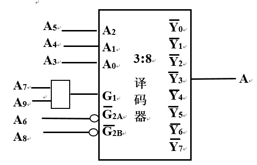

# 2026数字逻辑 - 第五周作业题目与作答清单

## 一、单选题

### R2-1 (分数: 2分)

简易模型机使用 74LS138 做指令译码，3 位操作码 001 对应 ADD 指令。当操作码为 001 且译码使能有效时，关于译码器的输出值 $\overline{Y_7}$ ···· $\overline{Y_0}$ ，描述正确的是（ ）。

**选项：**

- [ ] **A.** 10111111
- [ ] **B.** 11011101
- [x] **C.** 11111101
- [ ] **D.** 00000010

### R2-2 (分数: 2分)

图示电路，若实现图示功能。则译码器的地址输入端 $A_2A_1A_0$ 应接（ ）。

**选项：**

- [ ] **A.** 电路无法实现输出波形
- [x] **B.** 010
- [ ] **C.** 111
- [ ] **D.** 任意

### R2-3 (分数: 2分)

关于优先编码器，下面说法正确的是（ ）。

**选项：**

- [ ] **A.** 同一时刻只允许一个输入信号有效
- [x] **B.** 可用于中断控制器的优先级管理
- [ ] **C.** 优先编码器的输出，每次只有一个输出端出现有效电平
- [ ] **D.** 将74LS148（8-3）优先编码器扩充为16-4优先编码器时，两个芯片的优先级相同，可以同时各自独立编码，输出同时有效。

### R2-4 (分数: 2分)

用译码器74LS138实现8路数据分配器时，是用（ ）做数据输入端。

**选项：**

- [x] **A.** 低有效使能端
- [ ] **B.** 高有效使能端
- [ ] **C.** 数据端
- [ ] **D.** 地址端

### R2-5 (分数: 2分)

如图示电路中74LS138为3:8译码器，用16位地址总线 $A_{15}\sim A_0$ 选择各设备。则 X 设备的地址范围用16进制数表示为（ ）。

**选项：**

- [ ] **A.** 1000H~1400H
- [ ] **B.** 1000H~12FFH
- [x] **C.** 1000H~13FFH
- [ ] **D.** 1000H~1300H

### R2-6 (分数: 2分)

8:3优先编码器74LS148，8条输入线I0--I7同时为有效电平（0）时，则输出编码为（ ）。

**选项：**

- [ ] **A.** 101
- [ ] **B.** 010
- [x] **C.** 000
- [ ] **D.** 111

### R2-7 (分数: 2分)

将图示2:4译码器扩充为4:16译码器，则至少需要（ ）个2:4译码器。（只能使用2:4译码器）

**选项：**

- [x] **A.** 5
- [ ] **B.** 4
- [ ] **C.** 3
- [ ] **D.** 6

### R2-8 (分数: 2分)

下图是共阴极七段LED数码管显示译码器框图，若要显示字符“5”，则译码器输出g～a应为（ ），g是高位。

**选项：**

- [ ] **A.** 1101100
- [ ] **B.** 1100011
- [ ] **C.** 0100100
- [x] **D.** 1101101

### R2-9 (分数: 2分)

数据分配器一般用（ ）实现其功能。

**选项：**

- [ ] **A.** 编码器
- [ ] **B.** 与非门
- [ ] **C.** 选择器
- [x] **D.** 译码器

## 二、主观题

### R8-1 分析芯片的地址范围 (分数: 10分)

如图所示，74LS139为2:4译码器，分析给出III号存储器芯片的地址范围（用16进制数表示）。

答案直接写在答题框内。

---

### R8-2 描述地址范围 (分数: 10分)

分析写出图中译码器能译中的地址范围，及设备A的地址范围。（用16进制数表示）

---

### R8-3 第二章第（13）题 (分数: 10分)

用一片4:16线译码器将8421BCD码转换成余三码，写出表达式，画出逻辑图。
