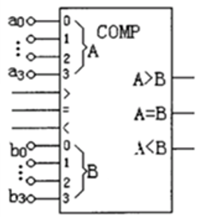
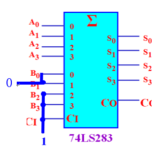
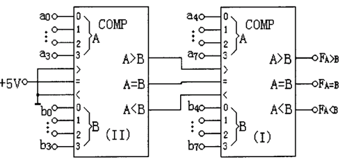
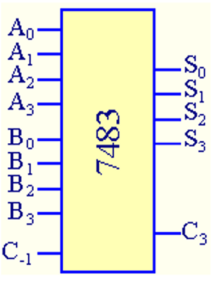
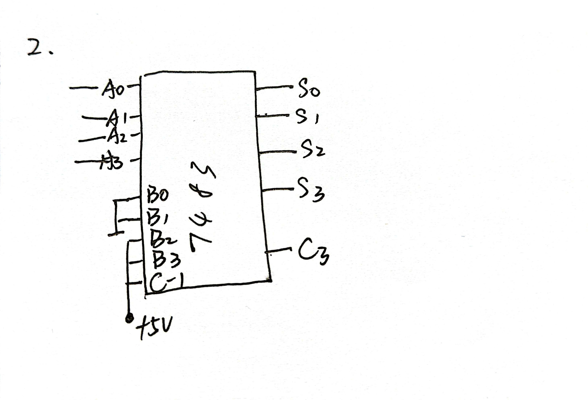

# 2026数字逻辑 - 第六周作业题目与作答清单

## 一、单选题

### R2-1 (分数: 2分)

4 位全加器实现无符号减法 $A-B，A=3，B=5$ ，A二进制 0011 ，B二进制 0101 。下列说法正确的是（）。

**选项：**

- [ ] **A.** 输出和 1110 ， $C_3=1$ ，无借位（CF=0）
- [ ] **B.** 输出和 0110 ， $C_3=0$ ，存在借位（CF=1）
- [x] **C.** 输出和 1110 ， $C_3=0$ ，存在借位（CF=1）
- [ ] **D.** 输出和 0110 ， $C_3=1$ ，无借位（CF=0）

### R2-2 (分数: 2分)

已知两个四位二进制数A和进行比较，电路连接如图所示，比较器芯片的三个级联输入端>, = ,< 的信号应依次接入为（ ）。

**选项：**

- [ ] **A.** 111
- [ ] **B.** 101
- [ ] **C.** 000
- [x] **D.** 010

### R2-3 (分数: 2分)

图示逻辑电路的功能是（ ）。

**选项：**

- [x] **A.** 余3码转8421码
- [ ] **B.** 二进制码转循环码
- [ ] **C.** 8421码转余3码
- [ ] **D.** 循环码转进制码

### R2-4 (分数: 2分)

串行进位加法器，描述正确的是（ ）

**选项：**

- [x] **A.** 加法器求和的最高位输出必须等到各位进位信号逐位传递后才能形成。
- [ ] **B.** 加法器采用串行进位，工作速度很快。
- [ ] **C.** 加法器最高位的求和输出, 直接由两位最高位的运算产生
- [ ] **D.** 串行进位加法器比超前进位并行加法器延迟时间短。

### R2-5 (分数: 2分)

串行加法器加法器的进位信号采用（ ），并行加法器的进位信号采用（ ）

**选项：**

- [ ] **A.** 超前，逐位
- [x] **B.** 逐位，超前
- [ ] **C.** 逐位，逐位
- [ ] **D.** 超前，超前

### R2-6 (分数: 2分)

4 位全加器用补码实现有符号减法 A-B，A=-6，B=3；A=-6（补码1010），B=3（补码0011），下面说法正确的是（ ）。

**选项：**

- [x] **A.** 输出和 0111 ， $C_3=1,C_2=0，OF=1$ ，发生溢出
- [ ] **B.** 输出和 1001 ， $C_3=1,C_2=1，OF=1$ ，发生溢出
- [ ] **C.** 输出和 1001 ， $C_3=0,C_2=1，OF=0$ ，无溢出
- [ ] **D.** 输出和 0111 ， $C_3=1,C_2=0，OF=0$ ，无溢出

### R2-7 (分数: 2分)

利用全加器74LS283将余三码转8421码，只需要加上（ ）即可。

**选项：**

- [ ] **A.** 0011，CI端接1
- [ ] **B.** 1100 ，CI端接1
- [x] **C.** 1101，CI端接1
- [ ] **D.** 1100，CI端接0

### R2-8 (分数: 2分)

已知两个八位二进制数A=11110111和B=11110100进行比较，电路连接如图7-1所示。I号芯片的三个级联输入端 >、=、< 的信号分别是（ ）。

**选项：**

- [ ] **A.** 0、0、1
- [x] **B.** 1、0、0
- [ ] **C.** 0、1、0
- [ ] **D.** 0、0、0

## 二、主观题

### R8-2 第二章第（14）题 (分数: 10分)

#### 题目描述

使用一个4位二进制加法器设计将余三码转换成8421BCD码的转换器。

#### 提交答案 / 作答内容

---
