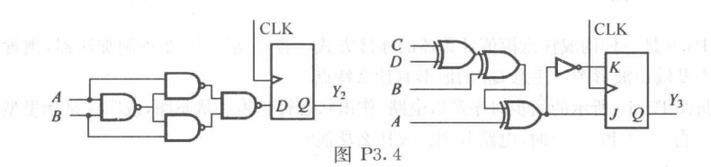

# 2026数字逻辑 - 第七周作业题目与作答清单

## 一、单选题

### R2-1 (分数: 2分)

JK触发器在CLK脉冲作用下，欲使 $Q^{(n+1)}=Q^{n}$，则输入信号应为（ ）。

**选项：**

- [ ] **A.** $J=\overline{Q},\ K=Q$
- [ ] **B.** $J=\overline{Q},\ K=1$
- [ ] **C.** $J=K=1$
- [x] **D.** $J=K=0$

## 二、主观题

### R8-1 第三章第（3）题 (分数: 10分)

#### 题目描述

已知JK信号如图，请画出负边沿JK触发器的输出波形（设触发器的初态为0）。

#### 提交答案 / 作答内容

*(本题作答要求在试卷/答题卡上手绘输出波形)*

---

### R8-2 第三章第（4）题 (分数: 10分)

#### 题目描述

写出图3.4所示各触发器次态方程，指出CP脉冲到来时，触发器置“1”的条件。
提示：先写出D, J, K的表达式，再根据状态方程确定置1的条件。

#### 提交答案 / 作答内容

*(见教材及课件相关推导)*

---

### R8-3 第三章第（5）题 (分数: 10分)

#### 题目描述

写出各触发器的次态方程，并按所给的CP信号，画出各触发器的输出波形（设初态为0）。
说明：图示画法中悬空的引脚K都表示接高电平‘1’ ，这种是不严格画法。正确的画法是将输入端的K端都接入确定的高电平。

#### 提交答案 / 作答内容

*(本题作答要求在试卷/答题卡上手绘输出波形)*

---
