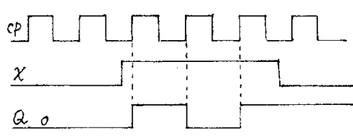
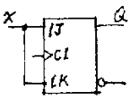
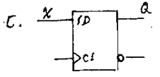
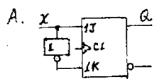
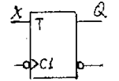
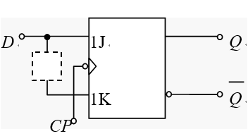
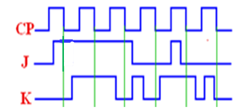
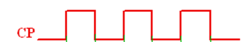
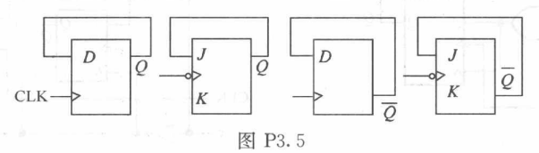

# 2026数字逻辑 - 第七周作业题目与作答清单

## 一、单选题

### R2-1 (分数: 2分)

下列各触发器中，图（ ）触发器的输入、输出信号波形图如下图所示。

**选项：**

- [x] **A.** 
- [ ] **B.** 
- [ ] **C.** 
- [ ] **D.** 

### R2-2 (分数: 2分)

由或非门构成的RS触发器，为避免不定状态的发生，输入不能出现（ ）。

**选项：**

- [x] **A.** R=S=1
- [ ] **B.** R=0,S=1
- [ ] **C.** R=S=0
- [ ] **D.** R=1,S=0

### R2-3 (分数: 2分)

为实现将JK触发器转换为D触发器，图所示电路的虚线框内应是_________。

**选项：**

- [ ] **A.** 异或门
- [x] **B.** 非门
- [ ] **C.** 或门
- [ ] **D.** 与非门

### R2-4 (分数: 2分)

由与非门构成的RS触发器，为避免不定状态的发生，输入不能出现（ ）。

**选项：**

- [ ] **A.** R=1,S=0
- [ ] **B.** R=0,S=1
- [x] **C.** R=S=0
- [ ] **D.** R=S=1

### R2-5 (分数: 2分)

由与非门构成的基本 RS 触发器，R、S 此时同为低电平0，下列说法正确的是（ ）。

**选项：**

- [ ] **A.** R=S=0，触发器保持原有状态不变。
- [ ] **B.** R=S=0, $Q=1,\overline{Q}=1$；R、S 同时撤去，随即输入R=S=1，最终状态无法预测
- [x] **C.** R=S=0同时撤去后，随即输入R=0,S=1，触发器状态不定
- [ ] **D.** R=S=0时，输出 Q 为不定态

### R2-6 (分数: 2分)

下列关于功能冒险消除方法的说法正确的是（ ）。

**选项：**

- [ ] **A.** 化简逻辑表达式，可消除功能冒险
- [x] **B.** 使用格雷码作为输入编码，能够避免产生功能冒险
- [ ] **C.** 将逻辑表达式中加入冗余项，可消除功能冒险
- [ ] **D.** 功能冒险由门延迟引起，更换高速门即可消除

### R2-7 (分数: 2分)

下面关于功能冒险的描述，错误的是（ ）。

**选项：**

- [ ] **A.** 功能冒险属于组合逻辑电路可能出现的现象
- [x] **B.** 修改逻辑表达式，能够消除功能冒险
- [ ] **C.** 即便电路不存在逻辑冒险，依然有可能出现功能冒险
- [ ] **D.** 功能冒险发生在两个或多个输入变量同时变化时

### R2-8 (分数: 2分)

下列表达式中不存在竞争冒险的是（ ）。

**选项：**

- [ ] **A.** $F=A\overline{B}D+\overline{A}\,\overline{C}+\overline{B}\,\overline{C}D$
- [x] **B.** $F=(A+B)\cdot(\overline{A}+D)$
- [ ] **C.** $F=(A+\overline{B})\cdot(\overline{A}+D)\cdot(C+B)$
- [ ] **D.** $F=AB+\overline{A}C+\overline{B}D$

### R2-9 (分数: 2分)

JK触发器在CLK脉冲作用下，欲使 $Q^{(n+1)}=Q^{n}$，则输入信号应为（ ）。

**选项：**

- [ ] **A.** $J=\overline{Q},\ K=1$
- [ ] **B.** $J=\overline{Q},\ K=Q$
- [x] **C.** $J=K=0$
- [ ] **D.** $J=K=1$

### R2-10 (分数: 2分)

下列各函数等式中无冒险现象的函数式是（ ）。

**选项：**

- [ ] **A.** $F=\overline{A}\,\overline{C}+BC+A\overline{B}$
- [ ] **B.** $F=\overline{B}\,\overline{C}+AC+\overline{A}B$
- [ ] **C.** $F=\overline{B}\,\overline{C}+AC+\overline{A}B+A\overline{B}$
- [x] **D.** $F=\overline{B}\,\overline{C}+AC+\overline{A}B+BC+A\overline{B}+\overline{A}\,\overline{C}$

### R2-11 (分数: 2分)

下列有关组合电路中险象的叙述错误的是（ ）。

**选项：**

- [ ] **A.** 险象只发生在输入信号变化的时刻
- [ ] **B.** 是一种暂时的错误
- [x] **C.** 由于电路未达到最简引起的
- [ ] **D.** 由于电路的时延引起的

### R2-12 (分数: 2分)

函数 $F=\overline{A}C+AB+\overline{B}\,\overline{C}$，无冒险的组合为（ ）。

**选项：**

- [ ] **A.** $A=B=0$
- [ ] **B.** $B=C=0$
- [x] **C.** $B=C=1$
- [ ] **D.** $A=1,C=0$

### R2-13 (分数: 2分)

由或非门构成的基本 RS 触发器，R、S 此时同为高电平1，下列说法正确的是（ ）。

**选项：**

- [ ] **A.** 在 R=1,S=1 期间，输出 Q 立即进入不定态
- [ ] **B.** R=1,S=1 期间，触发器保持原有状态不变
- [ ] **C.** R=1,S=1 期间，$Q=0,\overline{Q}=0$；R、S 同时撤去后，随即输入R=S=0，最终状态无法预测
- [x] **D.** R=S=1同时撤去后，随即输入R=0, S=1时, 触发器状态不定。

## 二、主观题

### R8-1 第三章第（3）题 (分数: 10分)

已知JK信号如图，请画出负边沿JK触发器的输出波形（设触发器的初态为0）。

---

### R8-2 第三章第（4）题 (分数: 10分)

写出图3.4所示各触发器次态方程，指出CP脉冲到来时，触发器置“1”的条件。

提示：先写出D、J、K的表达式，再根据状态方程确定置1的条件。

---

### R8-3 第三章第（5）题 (分数: 10分)

写出各触发器的次态方程，并按所给的CP信号，画出各触发器的输出波形（设初态为0）。

说明：图示画法中悬空的引脚K都表示接高电平 `1`，这种是不严格画法。正确的画法是将输入端的K端都接入确定的高电平。

---
