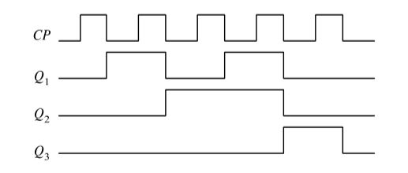
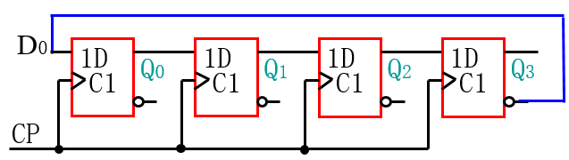
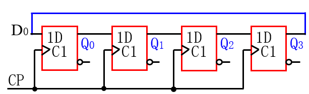
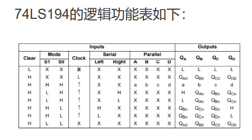
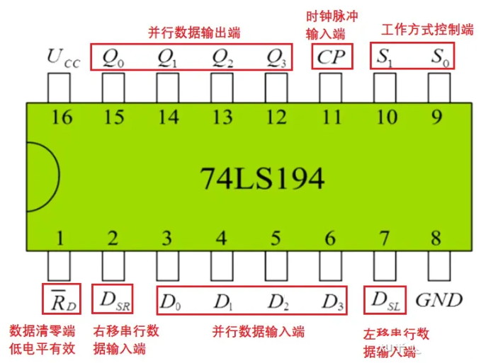
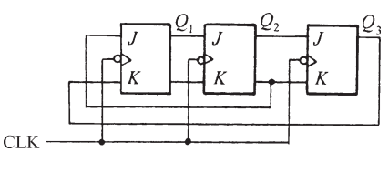
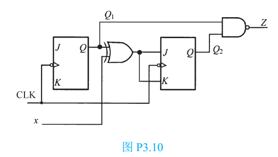
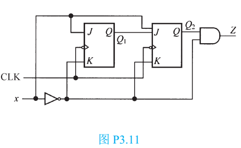

# 2026数字逻辑 - 第八周作业题目与作答清单

## 一、单选题

### R2-1 (分数: 2分)

由下图可知电路的逻辑功能是（ ）。

**选项：**

- [ ] **A.** 4进制计数器
- [ ] **B.** 8进制计数器
- [x] **C.** 5进制计数器
- [ ] **D.** 6进制计数器

### R2-2 (分数: 2分)

移位型计数器中有两种常用计数器，即环形计数器和扭环形计数器，其中扭环形计数器中，如果触发器级数为 $n$，则该计数器的计数模为（ ）。

**选项：**

- [ ] **A.** $n/2$
- [ ] **B.** $n$
- [x] **C.** $2n$
- [ ] **D.** $2^2$

### R2-3 (分数: 2分)

移位型计数器中有两种常用计数器，即环形计数器和扭环形计数器，其中环形计数器中，如果触发器级数为 $n$，则该计数器的计数模为（ ）。

**选项：**

- [ ] **A.** $2^n$
- [ ] **B.** $n/2$
- [x] **C.** $n$
- [ ] **D.** $2n$

### R2-4 (分数: 2分)

4位移位寄存器，串行输入时经（ ）个CP后，4位数码能全部移入寄存器中，若将其串行输出，则再需经（ ）个CP脉冲后，数码才能全部输出。

**选项：**

- [ ] **A.** 8，8
- [ ] **B.** 4，0
- [x] **C.** 4，4
- [ ] **D.** 8，0

### R2-5 (分数: 2分)

下图电路中，若起始是 1111，则经过 46 个 CP 后，状态 $Q_0Q_1Q_2Q_3$ 是（ ）。

**选项：**

- [ ] **A.** 0000
- [ ] **B.** 1000
- [x] **C.** 1100
- [ ] **D.** 1110

### R2-6 (分数: 2分)

下图电路中，若起始是 1110，则经过 62 个 CP 后，状态 $Q_0Q_1Q_2Q_3$ 是（ ）。

**选项：**

- [ ] **A.** 0111
- [ ] **B.** 1100
- [x] **C.** 1011
- [ ] **D.** 1101

### R2-7 (分数: 2分)

若产生 10 路顺序脉冲，仅用四位双向移位寄存器 74LS194，不能使用其他逻辑门，则至少需要（ ）片。

**选项：**

- [ ] **A.** 10
- [ ] **B.** 5
- [x] **C.** 3
- [ ] **D.** 2

## 二、主观题

### R8-1 第三章第7题 (分数: 10分)

分析如图所示电路，写出各触发器状态方程、电路真值表、状态图（按 $Q_3Q_2Q_1$ 的顺序）。说明电路是几进制计数器，能否自启动。

---

### R8-2 第三章第13题 (分数: 10分)

分析图示电路，写出输出方程、状态方程、真值表、状态图（$Q_2Q_1$），说明电路的逻辑功能。

---

### R8-3 第三章第14题 (分数: 10分)

分析图示电路，写出输出方程、状态方程、真值表、状态图（$Q_2Q_1$），说明电路的逻辑功能。

---
