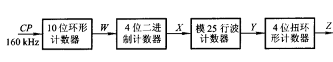
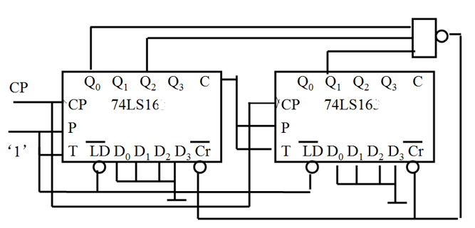
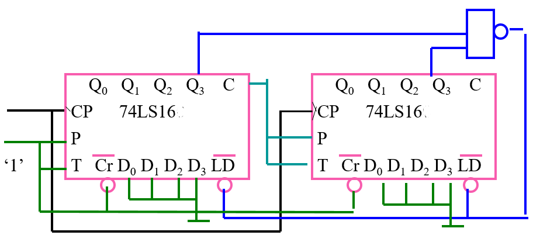
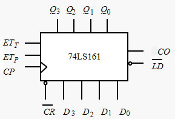
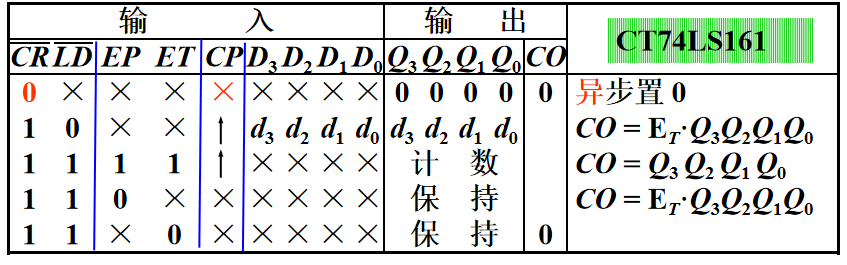

# 2026数字逻辑 - 第九周作业题目与作答清单

## 一、单选题

### R2-1 (分数: 2分)

电路中 W、X、Y、Z 各点的频率为（ ）。

**选项：**

- [ ] **A.** 16KHz, 2KHz, 80Hz, 20KHz
- [ ] **B.** 16KHz, 4KHz, 160Hz, 40Hz
- [x] **C.** 16KHz, 1KHz, 40Hz, 5Hz
- [ ] **D.** 16KHz, 1KHz, 40Hz, 10Hz

## 二、主观题

### R8-1 分析图示计数器的模值 (分数: 10分)

电路如图示，分别写出当芯片为 74LS160、74LS161、74LS162、74LS163 时，计数器的模值。

---

### R8-2 分析计数器的模值（2） (分数: 10分)

分析图示电路的模值，当芯片分别为 74LS160、74LS161、74LS162、74LS163 时。

---

### R8-3 设计100进制计数器 (分数: 10分)

使用 74LS161 和必要的门电路设计 100 进制计数器，要求使用 Load 端，且必须出现 0 状态。

---
