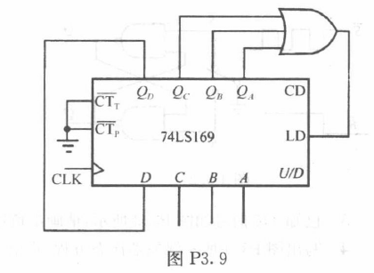
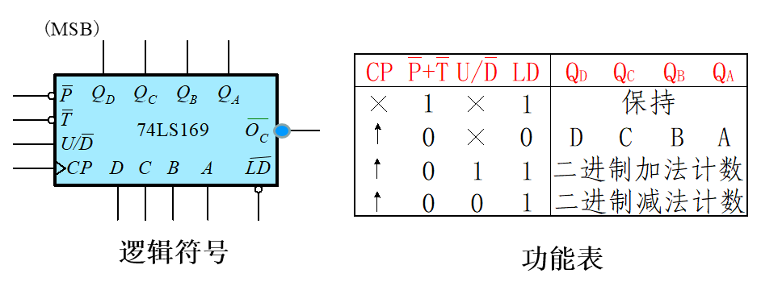
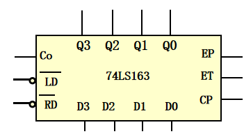
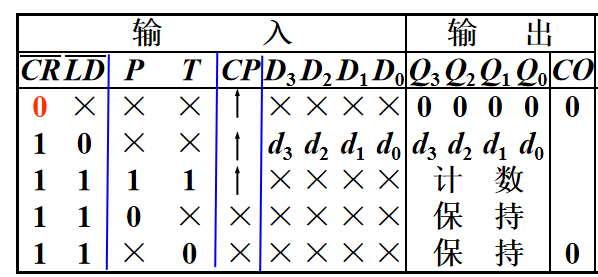

# 2026数字逻辑 - 第十周作业题目与作答清单

## 一、单选题

### R2-1 (分数: 2分)

顺序脉冲（节拍脉冲）发生器的功能是（ ）。

**选项：**

- [ ] **A.** 检查串行数据流里指定的二进制序列，匹配成功输出高电平
- [ ] **B.** 产生连续周期的方波时钟信号
- [x] **C.** 在时钟脉冲作用下，依次在各个输出端轮流输出有效电平
- [ ] **D.** 对输入脉冲做分频，得到低频时钟

### R2-2 (分数: 2分)

由 3:8 译码器 + 计数器构成的顺序脉冲发生器，最多有多少路顺序节拍输出（ ）。

**选项：**

- [ ] **A.** 3
- [ ] **B.** 16
- [x] **C.** 8
- [ ] **D.** 7

### R2-3 (分数: 2分)

序列信号发生器的核心功能是（ ）。

**选项：**

- [ ] **A.** 在串行输入中查找指定序列，匹配成功输出标志
- [ ] **B.** 对输入时钟进行分频
- [x] **C.** 在时钟作用下，循环输出一组固定的串行二进制序列
- [ ] **D.** 产生多路依次轮流有效的节拍脉冲

## 二、主观题

### R8-1 第三章第（12）题 (分数: 10分)

图 P3.9 是一种构成任意模值计数器的连接方式。若要连接成 12 进制加法器，预置值应为多少？画出状态及输出波形图。注意 $Q_D$ 的波形有什么特点。

（可以不用画波形图，只需给出计数器的状态图即可）

---

### R8-2 第三章第（9）题 (分数: 10分)

用 D 触发器构成按循环码 $(000\to 001\to 011\to 111\to 101\to 100\to 000)$ 规律工作的六进制同步计数器。要求写出真值表、输出方程和激励方程。检查所设计的电路能否自启动。

---

### R8-3 改动的第三章第（15）题 (分数: 10分)

设计“101”序列信号检测器，并规定检测的 101 序列不重叠。只需给出编码后的状态图，要求按格雷码编码。

---

### R8-4 同步时序电路设计 (分数: 10分)

只做出编码后的“1001”序列信号检测器的状态图，检测的序列不重叠，当输入“1001”时，输出为 1。状态图中的各状态按自然二进制码编码。

---

### R8-5 设计模8计数器 (分数: 10分)

使用 74LS163 分别设计 3 种模 8 计数器。

（1）必须出现 0000 状态。
（2）不能出现 0000 和 1111 状态，必须出现 0011 状态。
（3）除了 74LS163 之外，只能使用一个非门。

---
